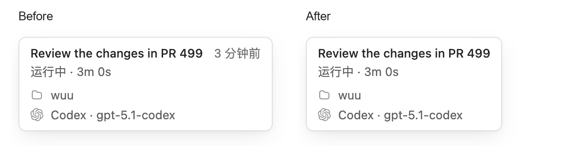
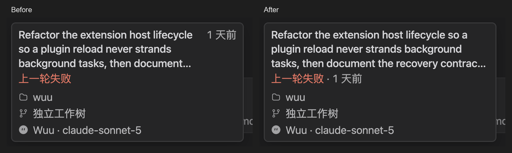

# Sidebar hover-card status and time — PR evidence

Synthetic sessions rendered by the existing Electron sidebar hover-card E2E script.
This branch stores review attachments only and is not intended to merge into main.

- Before: `d1ca64f27f7f` (main before this change).
- After: `a4702ff5d` (`fix/sidebar-hover-card-time`).
- Running comparison: light theme, 14px UI preference, 1200 × 820 CSS-pixel window.
- Long-title comparison: dark theme, 20px UI preference, 900 × 820 CSS-pixel window.
- Both sides use the same fixture, locale, window size and display scale.
- Images are unscaled crops of actual renderer screenshots, placed side by side
  with Before/After labels. No card content has been redrawn or edited.

## Reproduction

At each source revision, from `desktop/` with dependencies installed:

```sh
npx electron-vite build
npx electron scripts/sidebar-hover-card-e2e.cjs
```

The script writes full screenshots and `results.json` to
`desktop/out/sidebar-hover-card-e2e-*`. Both revisions passed all 48 cases.
The patched revision also passed desktop TypeScript checking, 51 existing
ThreadSidebar/AppSidebarDrawer tests, and `make test-policy-check`.




